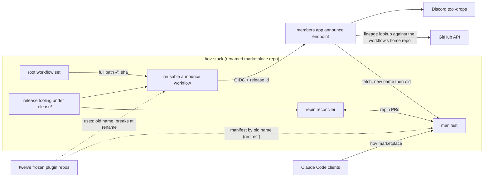
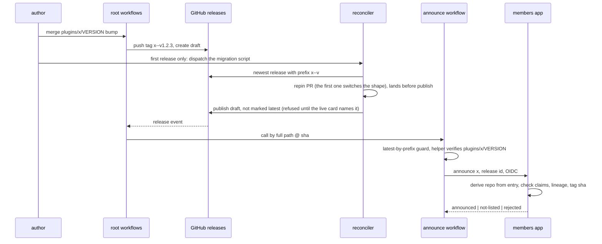
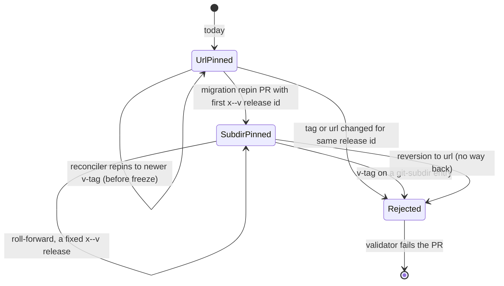
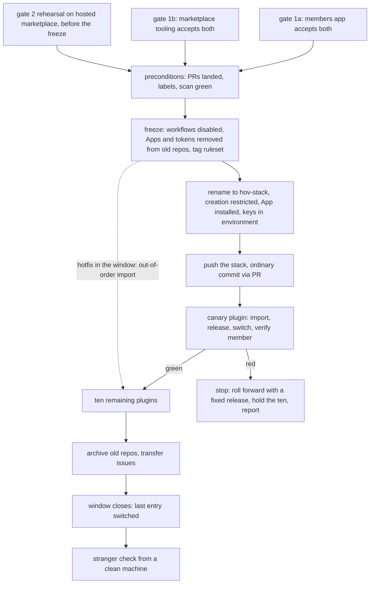
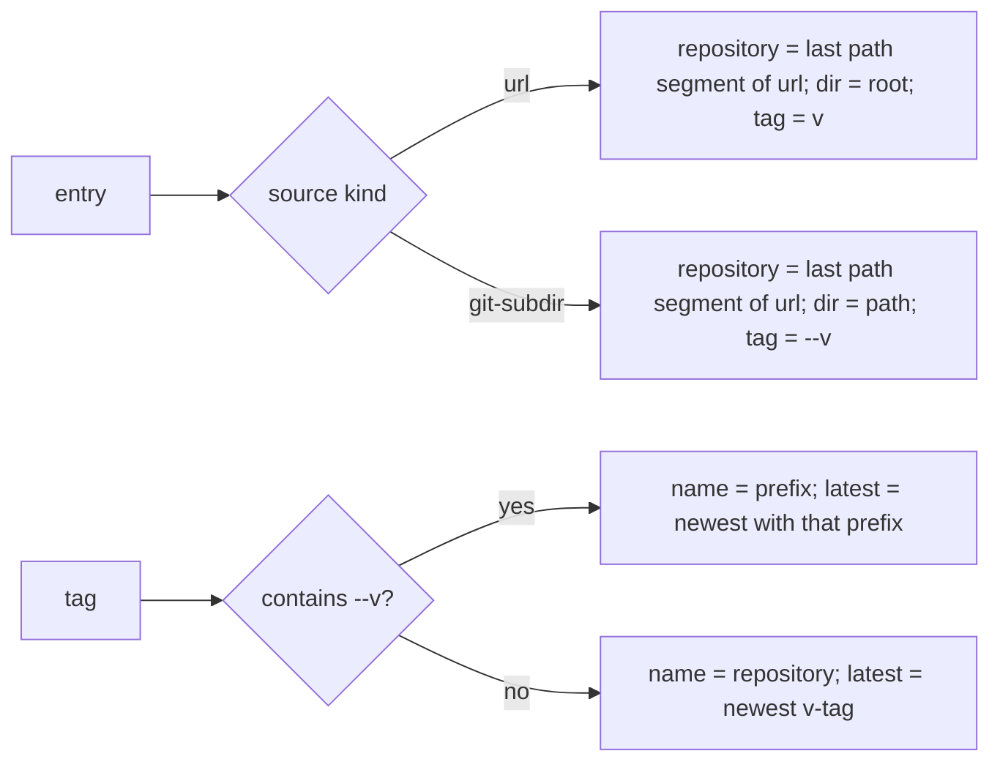

# hov-stack restructure: announce chain, root release train, staging repo, flip runbook - Plan

## Goal Capsule

**Objective.** Turn the architecture decision record (`docs/decisions/2026-10-20-hovstack-architecture.md`) into sequenced, testable units across the three code bases the plugin announce chain spans (the members app, the marketplace repo, this staging repo), plus the ordered runbook for the flip that produces `StartupBros-com/hov-stack`.

**Means.** The announce chain is rewritten first and additively (KTD1): the members app and the marketplace tooling accept both the per-repo shape used today and the monorepo shape, and both are deployed before the rename. Each plugin's manifest entry changes shape only inside its first monorepo release (KTD2). The staging repo is flattened into the drop-in stack privately (Stream C) and pushed into the renamed repo as one ordinary commit on existing history (KTD6). The flip is a runbook with an enforced freeze (KTD7), a rehearsed and canaried gate 2 (KTD8), and a stated cutover window.

**Authority.** The decision record and `STRATEGY.md` (tracks "Drop-in" and "The plugin train"), both merged on main. The author owns every step marked `Deploys: author`; this plan proposes and sequences, it does not schedule the flip.

**Stop conditions.** Stop and report rather than proceed when: a unit would require the manifest directory in the staging repo before the flip; a unit would require a second marketplace name; the public-safety scan (U18) fails on the tree about to be pushed; the gate-2 rehearsal (U21) shows an installed plugin breaking across the entry switch; a step would force-push or replace the marketplace repo's history; the canary is red and no roll-forward release fixes it (a switched entry never reverts to `url`, KTD16); or the rename is about to run without the shared-repository controls in R46-R49 in place.

---

## Product Contract

### Summary

Twelve Claude Code plugins live in twelve public repos today, each with its own copy of a four-workflow release train that announces releases to members through a reusable workflow in the marketplace repo and an OIDC-authenticated endpoint in the members app. The staging repo holds the author's harness as a private, not-yet-public stack. After this work there is one public repo, `StartupBros-com/hov-stack`, produced by renaming the marketplace repo: the stack at its root, the plugins under `plugins/<name>/` released on `<name>--v<version>` tags, one root workflow set, the same `hov` marketplace name, and an announce chain that accepted both shapes before anything moved.

### Problem Frame

The announce chain is the constraint. The members app validates the whole manifest and refuses any entry that is not the per-repo shape; the marketplace validator forbids changing an entry's url, tag or sha for an existing release id; every plugin repo's release train references the reusable workflow by the marketplace repo's name, which GitHub does not redirect for workflow references. A flag-day switch would therefore take every announcement down and leave no path to fix it through the chain itself. The order has to be: accept both shapes, deploy, then move.

### Requirements

**Announce endpoint (members app)**

- R1. The manifest parser accepts `url` entries and `git-subdir` entries (`url`, `path`, `sha`) in one manifest. Every entry yields a plugin name and a GitHub repository as separate fields, the repository derived from the entry's source url. A `git-subdir` entry's url must equal the monorepo url exactly (a literal allowlist, not an owner prefix).
- R2. The tag rule follows the shape: `v<version>` for a `url` entry, `<name>--v<version>` for a `git-subdir` entry. The reverse pairing is rejected.
- R3. The OIDC `repository` claim must equal the entry's derived repository, and the `ref` claim must equal `refs/tags/<releaseTag>`.
- R4. The announce-workflow path check accepts the reusable workflow under either repository name (old or new); the lineage lookup URL is derived from the workflow's home repository as named in the `job_workflow_ref` claim, not from the caller's `repository` claim (the two differ in every old-shape call); lineage must still descend from the hardened baseline commit and the watched main branch. The old-name acceptance is time-boxed to a date stated in the change.
- R5. The manifest is fetched from the new repository name first and the old name second; the fallback happens only on a 404, never on invalid content.
- R6. The card keeps plugin name, version and the install line `/plugin install <name>@hov`; the ledger key stays (plugin name, release id); duplicate suppression is unchanged.
- R7. A request in today's shape produces the same decision, card and ledger row as before the change (parity).
- R8. The scheduled sweep resolves live releases through the derived repository, so a `git-subdir` entry is swept against the monorepo.

**Marketplace tooling (marketplace repo, later `release/` in hov-stack)**

- R9. The validator accepts both entry shapes. An entry may change shape only from `url` to `git-subdir`, only together with a new release id and the matching tag rule, and never back; every other change to url, tag, sha, version, shape or path for an existing release id stays forbidden. A `git-subdir` entry's url is a literal allowlist of one repository, its `path` equals `plugins/<name>`, its tag is non-empty and its sha is an ancestor of that repository's main. A plugin name never contains `--`.
- R10. For a `git-subdir` entry the validator's remote-layout checks read `plugins/<name>/` (VERSION, plugin manifest, skills) and the root workflow set, and skip the per-repo root requirements (root VERSION, root release train, root skill directory) that still apply to `url` entries; the release-train reference check accepts either repository name during the window; `hov-stack` is an allowed entry name.
- R11. The announce helper derives the plugin name and its directory from the tag when the tag contains `--v`, else from the repository name and the root.
- R12. The latest-stable guard lists releases, filters by tag prefix, paginates and orders by semver, not creation date; it never calls the repository-wide latest release; a skip prints the same not-announced marker the helper prints, never a silent no-op.
- R13. No publish step marks a release "latest" in the shared repo, neither the staged-publish workflow nor the repin publisher.
- R14. The repin scripts pick the newest release by tag prefix for a `git-subdir` entry. A one-time migration script writes a plugin's first `git-subdir` entry from its first prefixed release.
- R15. One root workflow set: auto-release fires on a `plugins/<name>/VERSION` change; release fires on `*--v*` tags with a gate scoped to that plugin's checks plus the stack's required checks; staged publish; release-train calls the reusable workflow by full `owner/repo/path@sha`. The set reads the manifest from its own checkout, never over a raw URL, and carries no user-token fallback.
- R16. Per-plugin CI runs as `ci / <name>` with path filters and carries each plugin's lockstep (VERSION equals plugin manifest version) and skill-presence checks; one always-running aggregate check is the only CI name branch protection requires, so a PR that touches no plugin path is never left pending; the release-notes checker runs on bump PRs against `plugins/<name>/docs/release-notes/`.
- R17. CI asserts that the sha every per-plugin caller pins and the hardened baseline commit remain ancestors of main's HEAD.
- R18. The hold-back levers (delete or re-draft the draft before the card lands; disable the reconciler) survive and are documented for the monorepo.

**Staging repo (Stream C)**

- R19. Every `wstack` token becomes `hov-stack` (23 files today, including setup, tests, systemd units and the gitleaks allowlist). Amended (author, 2026-10-24): the name was spelled `hovstack` until this date, and every token, variable and path now carries the hyphenated spelling; only the filenames of this plan and the decision record keep the old one, because issue links point at them.
- R20. The root mirrors `~/.claude`; other harnesses live under `harnesses/<name>`; `plugins/` and `release/` are reserved; no manifest directory exists before the flip.
- R21. The skills are canonical inside the skill-pack plugin directory and the root `skills/` path resolves to them; the pack's VERSION bump is the core release. Exception (author, 2026-10-23): a skill that needs files a plugin-only install lacks, such as the stack's scripts, lives in a stack-only skill directory that `./setup` links, and its skill file states any prerequisite a stranger must provide; a skill that needs the author's private files leaves the public tree for the overlay (U16).
- R22. `NOTICE.md` lists third-party material; every third-party skill carries its licence file.
- R23. `./setup` installs dcg by default with checksum and signature verification, supports `--no-dcg`, discloses dcg's licence status, selects the right release asset for the platform, soft-fails each step with a printed fix, and offers `--check`.
- R24. `./setup` adds the `hov` marketplace, installs the default plugins, and links only the skills no default plugin provides. Amended (author, 2026-10-24): it no longer records a `plugins.lock`; that record's only consumer was a `--check` drift row, and Claude Code already reports installed versions.
- R25. `./setup` checks and the README states the minimum Claude Code version.
- R26. Machine-private values are read from `~/.config/hov-stack/`; the public tree carries none.
- R27. A guided in-session setup skill walks through pro-gate, wsl-cdp, token-eater, product-video and sign-it.
- R28. A public-safety scan runs in CI and gates the push: no home-directory paths, personal email, private repository names or hostnames; suites that read private files are excluded, not failing.
- R29. The README, CONTRIBUTING and SECURITY are rewritten for the public repo (install line, agent prompt, marketplace, what is and is not here, minimum version).
- R30. The existing stack CI (setup test, hook suites, test runner, secret scan) stays green through every Stream C change.

**Flip**

- R31. The freeze is enforced before the rename: release workflows disabled in the twelve repos and a tag ruleset in place.
- R32. Open pull requests in the twelve repos are landed or closed, and transfer labels exist, before any import.
- R33. The marketplace repo is renamed to `hov-stack`; the old name is never reused; the release App is installed on the renamed repo and its repository list updated.
- R34. The stack lands as one ordinary commit on existing history through a pull request, never a force push, and only after R28 passes on that tree.
- R35. Gate 2 is rehearsed on a GitHub-hosted marketplace before the rename; after it, one canary plugin moves first and the rest wait on its result.
- R36. Each plugin is imported as one squash commit into `plugins/<name>/`, checked for self-referencing URLs, given path-filtered CI, released once on its prefixed tag, and its entry switched inside that release's repin PR; the announcement is verified from the run log.
- R37. Old plugin repos are archived with a pointer README only after their entry has switched; open issues are transferred; the private staging repo is archived last.
- R38. The cutover window is stated: it opens at the rename and closes when the last entry has switched; during it `url` entries still resolve to the frozen, not-yet-archived repos.
- R39. Every author-only step is marked as such.
- R40. A stranger-path check from a clean machine closes the flip.

**Cross-cutting**

- R41. Nothing announces from a user account; the App token and OIDC remain the only credentials in the chain.
- R42. Releases fire on the GitHub release event, as today.
- R43. This plan file is public-safe (it will live in the public repo).
- R44. The five sequencing rules of the decision record map to the units that enforce them.
- R45. Gate status is recorded with evidence, and open gates are marked open.

**Security posture (shared repository)**

- R46. The App private keys are readable only by workflows running from main (a protected environment with main as its sole deployment branch); every token-minting step declares it; no root workflow carries a user-token fallback.
- R47. Code-owner review is required for the release machinery, the manifest directory, every `VERSION`, `setup`, `hooks/` and the skill pack. The exemptions are the marketplace bot's manifest-only repin PR, which merges on green checks without a review so the chain stays automatic (KD8, AE3), and the author, who is the only code owner and cannot approve their own PR (KTD17); the release App bypasses nothing, and no bypass reaches the required checks.
- R48. The tag ruleset forbids creation, update and deletion of `*--v*` tags by anyone but the release App and the author; the marketplace bot is not in the bypass list; immutable releases are enabled where the organisation supports them.
- R49. Repository creation by organisation members is restricted before the rename, so the old name cannot be re-created; the twelve frozen repos are removed from both App installations and their user tokens revoked at the freeze; the members app's old-name acceptance is time-boxed. Amended (author, 2026-10-24): at the freeze the user tokens were revoked and the release App's installation was suspended rather than emptied, since an installation must list at least one repository; the marketplace bot's installation never listed the twelve. Every plugin repo leaves the release App's list in U22, before the installation is unsuspended. The old name's acceptance ends by removal, not by a configured date: the members app drops it in U22, before the rename.
- R50. Rollback of a switched entry is roll-forward only: a fixed prefixed release, never a reversion to `url`.

### Key Decisions

Product-level decisions carried from the merged decision record. Each is `session-settled: user-directed`.

- KD1. **One public repo, produced by renaming the marketplace repo** (session-settled: user-directed — chosen over hub-and-spokes and a fresh repo: keeps the marketplace name, the installed clients and the watched main branch). Governs R20, R33.
- KD2. **Plugins as `plugins/<name>/` on `<name>--v<version>` tags, pinned by `git-subdir` entries with a sha, marketplace name `hov` kept** (session-settled: user-directed — chosen over relative entries and a second marketplace name: members' existing `hov` registration keeps working). Governs R1, R2, R9, R14, R15.
- KD3. **The announce chain is rewritten first, additively, behind three gates** (session-settled: user-directed — chosen over a flag day: every announcement depends on it). Governs R7, R31, R35, R38.
- KD4. **Two-stage setup: deterministic `./setup` with dcg by default and an opt-out, then a guided in-session skill** (session-settled: user-directed — chosen over one scripted installer: the second stage needs logins and judgment). Governs R23, R24, R27.
- KD5. **Skills also ship as one skill-pack plugin; core releases announce on `hov-stack--v<version>`** (session-settled: user-directed — chosen over a separate skill-pack repo: one tree, one train). Governs R21.
- KD6. **The author's dotfiles become a private overlay read from `~/.config/hov-stack/`; the router stays out** (session-settled: user-directed — chosen over a softer edition: one stack). Governs R26.
- KD7. **Plugin histories are squash-imported; old repos archived with pointer READMEs; issues transferred; PRs landed or closed first** (session-settled: user-directed — chosen over history-preserving subtree merges: twelve histories would dominate the tree). Governs R32, R36, R37.
- KD8. **One root workflow set replaces the twelve copies; the repin bot is kept** (session-settled: user-directed — chosen over per-plugin workflow directories: one place to fix). Governs R14, R15.
- KD9. **The tool-drops channel announces every version update, as today** (session-settled: user-directed — chosen over core-only announcements). Governs R6, R42.

### Success Criteria

- The plan file exists on main at `docs/plans/2026-10-20-feat-hovstack-restructure-plan.md` with Stream A, Stream B, Stream C and Flip sections; every unit names its area, its tests and who deploys it.
- The ordering satisfies the five sequencing rules (table under Sequencing).
- The cutover design is "both shapes accepted, deployed before the rename", with the before-rename and any-time unit split stated.
- Gate status: gates 1a and 1b passed; gate 2's hosted rehearsal recorded with its evidence and its canary half open; gate 3 open.
- A grep of this file for the six public-safety tokens named in the tracking issue (home-directory paths, the members app's repository and app names, its endpoint module names, its hostname) returns nothing.
- CI on the PR is green.

### Scope Boundaries

**In scope.** The plan itself; the design of the additive announce change; the marketplace tooling and root workflow set; the staging repo's flatten, setup, overlay, skill-pack and README; the flip runbook with its window and gates.

**Deferred to Follow-Up Work.**

- Removing the old-name fallbacks from the members app and the reusable workflow once the cutover window has closed and the redirects have been observed for a release cycle.
- The plugin-install counter named under Key metrics in `STRATEGY.md`.
- A merge queue for the renamed repo if the repin convergence test (U9) shows starvation.
- Solution docs for the cutover (the learnings store has no prior art for OIDC lineage, repository renames or `git-subdir` sources).
- The `houseofvibe` organisation and the transfer that reserves it; independent of this plan.

**Non-goals (considered, not built).** Hub-and-spokes with a manifest repo; relative manifest entries; a second marketplace name; the stack root as a plugin; a single skill-pack repo for everything; a builder edition; moving the manifest into the staging repo before the flip; any flip date, org creation or VERSION bump decision.

### Acceptance Examples

- AE1. **Old shape after Stream A.** Given the members app has deployed U1-U3 and papercut's entry is still `url`, when papercut's release train announces `v0.1.22`, then the request is accepted on the same claims as before and the card and ledger row are identical to the pre-change fixture.
- AE2. **Prefixed tag on a url entry.** Given an entry is `url`, when a request arrives for tag `papercut--v0.1.22`, then it is rejected with the tag-rule reason and nothing is announced.
- AE3. **First monorepo release.** Given hov-stack holds `plugins/rent-check/` and the entry is still `url`, when the author bumps `plugins/rent-check/VERSION`, then the tag `rent-check--v0.3.2` is pushed, a draft release is created, the migration script (dispatched by hand, because the reconciler compares a `url` entry only against its own repo and cannot see the prefixed release) opens the repin PR that switches the entry to `git-subdir` with the new release id, that PR merges, the reconciler publishes the draft, and the announcement names rent-check 0.3.2 with `/plugin install rent-check@hov`.
- AE4. **Two plugins the same day.** Given pro-gate and sign-it both release after the flip, when sign-it's release train runs after pro-gate's, then the latest guard treats each as latest for its own prefix, and a re-run of pro-gate's earlier train is a no-op only if a newer `pro-gate--v` release exists.
- AE5. **Accidental bump in a frozen repo.** Given the freeze is enforced, when a VERSION bump merges in an old repo during the window, then no tag is pushed and no release is created, because the release workflows are disabled and the tag ruleset refuses the tag.
- AE6. **Member continuity.** Given a member has pro-gate installed from the `url` entry, when the entry switches to `git-subdir` and the member updates, then the installed version is the new one, the cache holds only the plugin subdirectory, enabled state and plugin data survive, and a wrong sha fails closed leaving the old install intact.
- AE7. **Stranger path.** Given a clean machine with git, node and a supported Claude Code, when a stranger clones hov-stack and runs `./setup`, then dcg is installed and verified, the `hov` marketplace is added, the default plugins are installed, and `./setup --check` reports every step green; offline, dcg is reported skipped with the command to run later.
- AE8. **Repin bot after the flip.** Given three entries are `git-subdir` and nine are still `url`, when the reconciler ticks, then each `git-subdir` entry is compared against the newest `<name>--v` release in hov-stack and each `url` entry against its own repo, and a second tick is a no-op.
- AE9. **Announce before repin.** Given a release was published by hand before its repin PR merged, when its release train runs, then the helper reports not-listed, exits green, and the sweep announces it after the repin lands.
- AE10. **Red canary.** Given the canary's entry has switched and a member reports a broken update, when the author decides, then the fix ships as a new prefixed release that the reconciler repins to; a PR that reverts the entry to `url` fails the validator (R50).
- AE11. **Claim parity.** Given a valid monorepo `repository` claim, when the request names a tag that belongs to another plugin's entry, then it is rejected with the tag-rule reason.

### Open Questions

Author-only calls. The author settled OQ1-OQ6 and OQ8 on 2026-10-23; OQ7 stays open.

- OQ1. Which plugin is the canary (U24)? Default: rent-check, the smallest install base with a normal workflow set. **Settled:** the default.
- OQ2. Does `harness-optimizer@hov` join the default plugin list (U15)? Its owner asks that installation never schedule or run optimisation. Default: not in the list until the author says so. **Settled:** the default.
- OQ3. Is the release App granted contents:write on hov-stack, and are the shared-repository controls in R46-R49 acceptable (environment-scoped keys, code-owner review, a tag ruleset that also forbids update and deletion, restricted repository creation) (KTD9, U22)? Default: yes to all. **Settled:** the default.
- OQ4. How should `./setup` word dcg's licence disclosure, given the upstream repo publishes no SPDX-detectable licence (U15)? Default: state that fact and link the upstream. **Settled:** before downloading anything, `./setup` says dcg is MIT-licensed with an added OpenAI/Anthropic rider that GitHub's licence detection does not recognise, links the upstream LICENSE, and names `--no-dcg` as the way to skip it.
- OQ5. Who creates the throwaway GitHub-hosted marketplace for the gate-2 rehearsal, and under which account (U21)? Default: the author, under the same organisation, deleted after the flip. **Settled:** the session creates two public scratch repos under the same organisation, `rehearsal-marketplace` and `rehearsal-monorepo`, so that no public repo carries the new name before the flip; they are deleted after the flip on the author's go (U26).
- OQ6. Does the core card carry a clone line for people who will not install the plugin (U3)? Default: yes, one line. **Settled:** the default.
- OQ7. The flip date. Not decided here.
- OQ8. Do the twelve migration releases carry a release note saying the plugin moved (U24)? They are bumps made to migrate, and each produces a card (KD9). Default: yes, the note names the new path and says nothing else changed. **Settled:** the default.

---

## Planning Contract

### Key Technical Decisions

- KTD1. **Accept both shapes, deploy, then rename** (session-settled: user-directed — chosen over a flag day: the registry rejects any entry it cannot parse and the rename breaks every per-plugin workflow reference, so the fix path would run through the broken chain). Governs the before-rename unit set under Sequencing.
- KTD2. **Each entry switches shape inside its plugin's first prefixed-release repin PR, opened by a migration script the author dispatches.** Chosen over switching all entries in one commit, and over switching at the same version with a new sha and no bump: the validator forbids changing url, tag or sha for an existing release id, so a switch needs a new release id, which needs a published release, which needs a VERSION bump. Nothing automatic triggers the switch: the reconciler compares a `url` entry only against its own repo. The cost is one bump per plugin made only to migrate, twelve cards in the channel (KD9, OQ8), plus the pack's first core card (U3). The guarantee is one update-available per plugin at the switch, because the new version rides with it. `url` and `git-subdir` entries coexist through the window.
- KTD3. **Plugin name and repository are separate derived fields; the request's name field keeps meaning plugin name.** Chosen over a new wire field: the ledger key, the card and the install line stay unchanged, and release ids are unique across GitHub.
- KTD4. **The latest-stable guard filters a paginated release list by tag prefix.** Chosen over the repository-wide latest release: a shared repo has one of those.
- KTD5. **Marketplace tooling moves to `release/` (scripts and tests), its docs to `docs/release/`, as one mechanical commit before any logic change (U5).** Chosen over leaving it at `scripts/` and `tests/` (those paths belong to the `~/.claude` mirror at the root, R20) and over relocating the mirror's own directories instead (that breaks the mirror). The move is safe for the twelve pinned callers because the reusable workflow checks out its own helper at the sha the caller pinned, so each pin keeps the layout it was published with. Workflow file names do not move.
- KTD6. **The stack lands as one ordinary commit on top of existing history, via PR.** Chosen over replacing main (every pinned workflow sha, including the one all twelve callers pin and the hardened baseline the members app requires, must remain an ancestor of main) and over an unrelated-histories merge that would also keep the pins reachable: the one-commit shape brings none of the private staging history, so the tree-only public-safety scan (U18) is sufficient where the marketplace's earlier public flip needed a full-history secrets scan. The cost is no `git blame` behind the stack's first commit.
- KTD7. **The freeze is a control: release workflows disabled and a tag ruleset.** Chosen over a convention: auto-release fires on any main push whose VERSION has no tag.
- KTD8. **Gate 2 is a GitHub-hosted rehearsal before the freeze plus a canary plugin after the rename.** Refines the decision record's member-continuity gate; chosen over a single post-switch test: the local pass used a directory-source marketplace, and a failure after ten entries have switched has no rollback except roll-forward (KTD16). The rehearsal runs before the freeze, because it needs only the validator (U6) and the freeze halts releases in twelve repos. The rehearsal is also what sets the Claude Code version floor (U15, U19) and exercises the sparse install of a skill pack (KTD11).
- KTD9. **Credential posture named, not hidden.** Today the release App writes to the plugin repos only and holds nothing on the manifest repo, and a contributor's blast radius is one plugin because the OIDC `repository` claim names it. After the flip two Apps reach one repo (the release App with contents write, the marketplace bot with contents and PR write), every plugin shares one `repository` claim, and any writer can push a branch. Separation falls to the tag prefix, the manifest entry, branch protection and path ownership. The compensations (R46-R49): App keys in a protected environment deployable from main only; only the release App in the tag ruleset's bypass; the ruleset forbidding creation, update and deletion of `*--v*` tags; code-owner review on the release machinery, manifest, VERSION files, `setup`, `hooks/` and the skill pack, with the bot's repin PRs and the author's own PRs as the exemptions (KTD17); repository creation restricted so the old name cannot be re-created; the twelve frozen repos removed from the App installations and their user tokens revoked; and the members app's binding of the `ref` claim to the entry's tag and of the tag sha to the manifest sha. The author confirms (OQ3).
- KTD10. **The release gate requires the plugin's own checks plus the stack's required checks; branch protection requires one always-running aggregate check.** Chosen over all-runs-green on the tagged commit (one plugin's red run would block every release, and path-filtered workflows produce zero runs, which the current "no CI run" timeout reads as failure) and over making each `ci / <name>` a required check (a path-filtered check never reports on a PR outside its path, which leaves that PR pending forever). The aggregate job always runs, decides from the changed paths what to wait on, and is the only name branch protection requires. The cost is that a red or flaky stack check blocks every plugin release.
- KTD11. **Skills are canonical inside `plugins/hov-stack/skills/`; the root `skills/` path is a link into it.** Chosen over the reverse (a `git-subdir` install holds only the subdirectory, so a link out of it dies in the sparse checkout) and over a CI-synced copy (drift). The tradeoff is a git symlink, which a Windows checkout may materialise as a text file; `./setup` therefore resolves the plugin path directly and never depends on the link. No pack skill may reference a root path such as `bin/` or `hooks/`, since those are absent from a sparse install (U14 test); the sparse install itself is checked at the hosted rehearsal (U21), because a directory source does not exercise it.
- KTD12. **`./setup` links only skills that no default plugin provides.** Chosen over linking everything: a duplicate skill name is a stop condition in the setup test, and papercut and design-drift exist both as skills and as plugins.
- KTD13. **Stage 1 soft-fails per step and prints the fix; `--check` reports state.** Chosen over fail-fast: a stranger offline or without the CLI should still get the links and a clear list of what is left.
- KTD14. **Imports come from `git archive` of each repo's main.** Chosen over local working trees: the checkouts carry worktree directories, and one plugin has no local checkout.
- KTD15. **The reusable workflow stops naming the marketplace repo literally.** The manifest repository becomes an input defaulting to the workflow's own home repository, which the workflow already reads for its trusted helper checkout. Chosen over defaulting to the caller's repository: that is right only after the flip, and a remaining per-repo caller would silently read a repo with no manifest. With the workflow-host default an old-shape caller and a monorepo caller both resolve to the right repo and no fixture needs an override.
- KTD16. **Rollback is roll-forward.** A switched entry never reverts to `url`: the validator forbids it (R9, R50), and a member who already updated to the subdirectory version cannot be downgraded. A red canary is fixed by a new prefixed release, or the remaining eleven plugins hold while the fix ships.
- KTD17. **The marketplace bot's repin PR and the author's own PRs are exempt from code-owner review, and from nothing else.** R47 as first written made every manifest change wait for a review, which would have stalled the repin PR that AE3, AE8 and R36 merge automatically and that KD8 keeps; and with the author as the only code owner, who cannot approve their own PR, it would have stalled every VERSION bump as well. Chosen over the author approving every repin PR (one click per release forever, and the chain is no longer automatic), over lifting the manifest out of code-owner review (a contributor's manifest edit would then land unreviewed), and over naming a second code owner for form's sake. Main carries the required aggregate check with no bypass, and the pull-request and code-owner-review rule with the marketplace bot and the author as its only bypass actors, as two rulesets so the two bypass lists stay separate. The control then guards a contributor's edits, which is what KTD9's blast-radius argument needs, and U22 proves the split rather than assuming it.

### High-Level Technical Design

Directional sketches, not prescriptions. Component names are roles, not files.

**Components and who calls whom**



**A monorepo release, end to end**



**Manifest entry states across the window**



**The flip as a lifecycle**



**Shape derivation, the decision points both validators share**



The tag split takes the last `--v<semver>`, and a plugin name never contains `--`; the validator is the only place a name is admitted (U6).

**Output structure after the flip** (directories only; the mirror's own layout is unchanged)

```text
hov-stack/
  CLAUDE.md  agents/  bin/  hooks/  mods/  scripts/  skills -> plugins/hov-stack/skills  workflows/
  plugins/<name>/        twelve plugins plus hov-stack (the skill pack)
  release/               marketplace scripts and tests
  .claude-plugin/        the manifest (arrives at the flip, not before)
  .github/               CODEOWNERS; workflows: stack CI, marketplace validate, the root release set
  dcg/  config/  docs/  harnesses/<name>/  tests/  windows/
  NOTICE.md  README.md  LICENSE  SECURITY.md  CONTRIBUTING.md  STRATEGY.md
```

### Assumptions

Inferred bets made without a synchronous user; each names where it is checked.

- A1. GitHub redirects git and web traffic from the old repository name (documented) and raw-content and REST calls too (not documented). The announce path does not depend on it: URLs derive from the OIDC claims, which carry the new name. Checked at U21 before the rename, for the manifest URL specifically; after the rename the members app's first URL is the new name, so the old-name fallback (R5) never fires on a redirect. U21 found REST and git redirect, and raw content serves the old name without a redirect once its five-minute cache expires (gate-2 record).
- A2. The OIDC `repository` and `job_workflow_ref` claims carry the new name after the rename. Checked by the canary announcement at U24.
- A3. A `git-subdir` entry behaves against a GitHub-hosted manifest as the directory-source rehearsal showed. Held at U21 on 2.1.76, 2.1.77 and 2.1.309; the minimum Claude Code version is 2.1.76 (gate-2 record).
- A4. A member whose `hov` marketplace was added from the old repository name keeps updating through the redirect. Held at U21; checked again on the canary at U24.
- A5. The reconciler converges with twelve plugins sharing one main: a stale repin PR is closed as superseded and reopened on the next tick. Checked by the two-plugins-in-one-hour test at U9.
- A6. The fold-in set is whatever the manifest holds at flip time, twelve entries today (the optimiser plugin joined after this plan's first draft); a thirteenth joins by being in the manifest.
- A7. `codex`, `fx`, `pi` and `pi-lens` move under `harnesses/`; `windows/` stays at the root as platform support.
- A8. The stack's CI and the marketplace's validate workflow coexist in one `.github/workflows/` with path filters added when they meet (U23); the validate workflow's public-sources job keeps its existing variable gate, runs on U23's PR and must be green there, and after the rename fetches `git-subdir` pins from the repo it runs in.
- A9. dcg's upstream repository publishes no SPDX-detectable licence; `./setup` states that and links the upstream (OQ4).
- A10. The skill pack is the plugin named `hov-stack`, installed with `/plugin install hov-stack@hov`; cloners do not install it, because `./setup` links the same skills.
- A11. The three open draft PRs in the marketplace repo are rebased into Stream B or closed before Stream B lands; none is merged as-is.
- A12. The marketplace's earlier public-flip runbook (its stop conditions and clean-history contingency) stays valid for that repo; U11 cross-references it and states that this plan's flip units supersede it for the rename.

### Sequencing

**Cutover design: both shapes accepted, deployed before the rename.** The window opens at the rename and closes when the last `url` entry has switched.

| Must be live before the rename | May land any time (private until the push) |
|---|---|
| U1-U4 deployed in the members app (gate 1a) | U12-U17, U19 in the staging repo |
| U5-U11 merged on the marketplace main (gate 1b) | U3's optional clone line |
| U18 scan green on the tree to be pushed | |
| U21 rehearsal (before the freeze), then U20 freeze and PR landing | |

**The five sequencing rules and their enforcing units (R44)**

| Rule (decision record) | Enforced by |
|---|---|
| The manifest does not move before the flip | U13 keeps `.claude-plugin/` absent; U23 brings the manifest in with the rename, not a copy |
| Entries change shape only after the registry accepts both | U1-U4 before U24; U6 permits the one-time transition only with a new release id |
| Nothing announces from a user account | U10 keeps App token and OIDC and carries no user-token fallback; U20 revokes the old repos' user tokens; U2 keeps the claim checks; R41, R46 |
| The announce workflow stays on the watched main branch | U6 and U10 keep the pin-is-ancestor check; the R17 ancestry assertion in U10; KTD6 |
| Releases fire on the GitHub release event | U10's release-train trigger; U8 keeps the draft and prerelease skips |

**Gate status (2026-10-25)**

| Gate | Status | Evidence |
|---|---|---|
| 1a members app accepts both | passed | U1-U4 merged in the members app on 2026-10-23; its production deploy of 2026-10-24 contains all four merges and reported success |
| 1b marketplace tooling accepts both | passed | U5-U11 merged on the marketplace main on 2026-10-21 and 2026-10-22, as PRs #216, #218, #220, #222, #224, #227 and #229 |
| 2 member continuity | rehearsal passed; canary open | The hosted rehearsal (U21) passed on Claude Code 2.1.76, 2.1.77 and 2.1.309, record below. The earlier directory-source pass on 2.1.305 agreed: the `url` to `git-subdir` update, a cache holding only the subdirectory, the old folder marked orphaned, enabled state and data kept, a wrong sha failing closed. The canary after the real rename (U24) is the open half (KTD8) |
| 3 the flip | open | runbook U20-U26; the U20 freeze in place since 2026-10-24; the U22 rename and controls recorded 2026-10-25 |

**Gate-2 rehearsal record (U21, 2026-10-23).** Two public scratch repositories in the same organization: a manifest repo holding a `hov` manifest, renamed partway through, and a monorepo holding a scratch plugin and a three-skill pack. Each client ran Claude Code 2.1.68 to 2.1.77 or 2.1.309 in a scratch home with no GitHub token; one 2.1.309 client had no SSH key. Every manifest state was checked by U6's validator, with its monorepo url aimed at the scratch monorepo, and landed through a pull request.

- **Version floor.** 2.1.68 to 2.1.75 refuse `marketplace add` for the whole manifest ("Unrecognized keys: "metadata", "card""), the release metadata and card every real entry carries; 2.1.76 and later read it. The live marketplace splits the same way today (2.1.75 refused, 2.1.76 read), so the floor predates this plan. The floor is 2.1.76 (U15, U19); versions older than 2.1.68 were not run.
- **AE6.** An installed plugin whose entry switched from `url` 0.3.1 to `git-subdir` 0.3.2 updated on 2.1.76, 2.1.77, 2.1.309 and the keyless 2.1.309. The cache held exactly the plugin's subdirectory at the pin and nothing outside it, the old version folder was marked orphaned, and enabled state and plugin data survived.
- **Wrong sha.** The validator refused the pin as not reachable from main. Clients given it anyway failed the checkout and stayed on the installed version, enabled, with data intact.
- **Sparse pack install (KTD11).** The pack installed on all four clients; its cache held every skill of the pack and nothing else from the monorepo. Two `git-subdir` plugins pinned to one monorepo commit installed side by side with separate caches on fresh 2.1.76, 2.1.77 and 2.1.309 clients.
- **Rename (A4).** After the manifest repo was renamed, clients that had added the marketplace under the old name updated 0.3.2 to 0.3.3 from a change landed only under the new name, kept data and enabled state, and still record the old name. A fresh `marketplace add` under the old name after the rename installed 0.3.3 on 2.1.76, 2.1.77, 2.1.309 and the keyless 2.1.309.
- **Old-name reads (A1).** REST answers 301 to the repository id and, followed, serves the new name's bytes. `git ls-remote` under the old name, over HTTPS without credentials and over SSH, returns the current main. Raw content answers 200 with no redirect: it served the pre-rename manifest from its cache (`max-age=300`) until that expired, then the current bytes.
- **Validator defect, fixed.** Full validation refused the pack-shaped entry because it required a skill named after the plugin, which the pack does not have; plugin CI had the same check. Both now require at least one skill directly under the pack's `skills/` (marketplace repo #231).
- **Not exercised.** The real rename and the canary (U24), the OIDC claims after a rename (A2), clients older than 2.1.68.

---

## Implementation Units

### Unit Index

| ID | Stream | Unit | Deploys | Before rename |
|---|---|---|---|---|
| U1 | A | Entry model: both shapes, derived fields | author (merge is deploy) | yes |
| U2 | A | Release identity: tag rule, claims, lineage | author | yes |
| U3 | A | Card, ledger, sweep | author | yes |
| U4 | A | Parity and planted-negative tests | author | yes |
| U5 | B | Land or close the three open drafts; move tooling to `release/` | session | yes |
| U6 | B | Validator: both shapes, one-time transition | session | yes |
| U7 | B | Announce helper: name and directory from the tag | session | yes |
| U8 | B | Reusable workflow: prefix guard, manifest input | session | yes |
| U9 | B | Repin scripts, migration script, convergence test | session | yes |
| U10 | B | Root workflow set and per-plugin CI | session | yes |
| U11 | B | Release docs and hold-back levers | session | yes |
| U12 | C | Token rename | session | no |
| U13 | C | Flatten, harnesses, reserved directories | session | no |
| U14 | C | Skill pack, NOTICE, licences | session | no |
| U15 | C | `./setup` stage 1 | session | no |
| U16 | C | Private overlay | session | no |
| U17 | C | Guided setup skill | session | no |
| U18 | C | Public-safety scan | session | yes (gate on push) |
| U19 | C | README, CONTRIBUTING, SECURITY | session | no |
| U20 | Flip | Preconditions and freeze | author + session | yes |
| U21 | Flip | Gate-2 rehearsal on a hosted marketplace | session | yes |
| U22 | Flip | Rename, App installation | author | the rename |
| U23 | Flip | Push the stack | session, author merges | after |
| U24 | Flip | Per-plugin fold-in, canary first | session, author bumps | after |
| U25 | Flip | Archive and transfer | author + session | after |
| U26 | Flip | Post-flip verification and capture | session | after |
| U27 | C | Author host cutover | session, on the author's go | no |

### U1. Entry model: both shapes, derived fields

- **Area:** members app, announce endpoint. **Deploys:** author (a merge to its main deploys).
- **Goal:** one manifest parser that accepts `url` and `git-subdir` entries and yields plugin name, repository and plugin directory as separate fields.
- **Requirements:** R1, R5, R7. Implements KD2 via KTD3.
- **Dependencies:** none.
- **Approach:** the entry schema becomes a union of the two shapes; a derivation step produces `{name, repository, path}` where repository is the last path segment of the source url without `.git`, path is the root for `url` entries. The manifest URL list is tried in order, new name then old, with fallback on 404 only. Whole-manifest fail-closed stays as it is.
- **Test scenarios:** a manifest with both shapes parses and derives `papercut`/`papercut`/root and `pro-gate`/`hov-stack`/`plugins/pro-gate`; a `git-subdir` entry missing `path` or `sha` fails the manifest; a `git-subdir` url under a different repository of the same owner fails (literal allowlist, R1); a url not under the expected owner fails; the second URL is used when the first returns 404 and not when the first returns malformed JSON.
- **Verification:** the existing fixture manifest parses to identical derived fields as before the change.

### U2. Release identity: tag rule, claims, lineage

- **Area:** members app, announce endpoint. **Deploys:** author.
- **Goal:** accept a monorepo announcement on the same evidence standard as today's.
- **Requirements:** R2, R3, R4, R41. Implements KTD3, KTD9's identity binding.
- **Dependencies:** U1.
- **Approach:** tag rule by shape; the OIDC repository claim is compared with the entry's derived repository; the workflow-path check accepts the reusable workflow at either repository name, with the old name's acceptance time-boxed to a date read from the app's configuration, whose initial value the change states (R4, R49); the old name is needed only until the freeze, since frozen repos cannot call, so U20 sets the date to the freeze date once OQ7 is decided, and moving it is a configuration change, not a code change; the lineage API URL is built from the workflow's home repository in the `job_workflow_ref` claim, never from the caller's `repository` claim, because in every old-shape call those two differ; the lineage rule (descends from the hardened baseline and from the watched main branch) is unchanged; the live-release check (release by id, tag sha equals manifest sha) is unchanged. Amended (author, 2026-10-24): the date was never set. U22's members-app change removes the old name's acceptance and its configuration entry, after which an old-name token is refused like any other unknown workflow path.
- **Test scenarios:** old-shape request accepted on the old claims, with a fixture where the `repository` claim (the plugin repo) and the `job_workflow_ref` claim (the marketplace repo) differ and lineage is looked up against the latter; `git-subdir` entry with `hov-stack` claim and tag `pro-gate--v0.66.0` accepted; `v`-tag on a `git-subdir` entry rejected; prefixed tag on a `url` entry rejected; repository claim naming the plugin for a `git-subdir` entry rejected; a valid `hov-stack` claim with a tag that belongs to another plugin's entry rejected (AE11); workflow path under a third repository name rejected; the old-name path rejected after its date, and the date is read from configuration (superseded in U22: the old-name path is rejected outright).
- **Verification:** every rejection names its reason; no path logs the token.

### U3. Card, ledger, sweep

- **Area:** members app. **Deploys:** author.
- **Goal:** the member-facing card and the ledger are unchanged for both shapes; the sweep follows the derived repository.
- **Requirements:** R6, R8. Governed by KD9.
- **Dependencies:** U1.
- **Approach:** the card reads the plugin name, version and install line from the entry; the ledger key stays (plugin name, release id); the sweep resolves live releases through the derived repository. Optional: a clone line on the `hov-stack` card (OQ6).
- **Test scenarios:** the card for a `git-subdir` entry says `/plugin install pro-gate@hov`; the ledger refuses a duplicate (name, release id); the sweep for a `git-subdir` entry queries the monorepo's release; a migration release announced by the helper and then seen by the sweep yields one card (parity on the ledger key); the notes summary on the card strips mentions and links, since release notes stay editable by any writer after staging.
- **Verification:** the card snapshot for the old-shape fixture is byte-identical.

### U4. Parity and planted-negative tests

- **Area:** members app. **Deploys:** author.
- **Goal:** one end-to-end assertion that exercises writer and reader together for both shapes, plus planted negatives that must keep failing.
- **Requirements:** R7, R2, R3.
- **Dependencies:** U1-U3.
- **Approach:** one old-shape and one new-shape request pass through the same validator path with recorded claims; a near-identical malformed pair per rule is refused. No existing test asserts that a prefixed tag, a `git-subdir` source or a `hov-stack` claim is rejected today, so the additive change breaks no assertion and needs this coverage.
- **Test scenarios:** as listed under U2, assembled as one parity suite, with one claim-parity case per claim (a valid monorepo `repository` claim paired with another entry's tag, a valid `ref` claim paired with another entry's release id); a snapshot of the old-shape decision taken before the change is compared after it.
- **Verification:** the suite runs in the members app's CI; the planted negatives are listed by name in the PR body.

### U5. Land or close the three open drafts; move tooling to `release/`

- **Area:** marketplace repo. **Deploys:** session.
- **Goal:** Stream B starts from a main that holds or has consciously dropped the in-flight announce fixes, and whose scripts and tests already live at `release/`.
- **Requirements:** R32 (for this repo), A11. Implements KTD5.
- **Dependencies:** none.
- **Approach:** first the drafts: the one that shares the release-identity predicate (announce helper and its test) is rebased into U7; the fail-closed pin-roll draft (currently conflicting) is rebased into U9 or closed with the reason; the checksum-pinned CI tools draft lands first on its own if green. Then one mechanical commit moves `scripts/` and `tests/` to `release/` with no logic change: the validate workflow's hard-coded script and test lists, the reconcile workflow's script paths, the validator's own repo-root derivation and every test's root derivation are rewritten to the new location; the workflow file names stay where they are, because the validator and the twelve callers name them; the public-sources job keeps its variable gate. The runbook and the release recipe move to `docs/release/` in U11.
- **Test scenarios:** every existing test runs green from `release/` with no assertion changed; a grep of `.github/workflows/` for the old `scripts/` and `tests/` paths returns nothing; the validate workflow's full job still runs under its variable.
- **Verification:** no open draft touches a file Stream B rewrites; the move commit's diff is renames plus path strings only.

### U6. Validator: both shapes, one-time transition

- **Area:** marketplace tooling (validator and its test). **Deploys:** session.
- **Goal:** the validator accepts both entry shapes and permits exactly one kind of shape change.
- **Requirements:** R9, R10, R17. Implements KTD2.
- **Dependencies:** U5.
- **Approach:** the manifest is `.claude-plugin/marketplace.json` in the marketplace repo and stays there; the entry schema allows `{source: url, url, sha}` and `{source: git-subdir, url, path, sha}`; the name rule gains `hov-stack` and forbids `--` in any name (the validator is the only place a name is admitted); for a `git-subdir` entry the url must equal the monorepo url as a literal, which the validator reads from one configuration value so the rehearsal (U21) can point it at a scratch repo without touching the check, `path` must equal `plugins/<name>`, the tag must be non-empty, and the sha must be an ancestor of that repository's main (a reachable sha is not a main sha once the repo hosts forks' objects); the monotonicity tuple compared for an existing release id grows from version, sha, tag and url to include shape and path, and the only permitted shape change is `url` to `git-subdir` with a new release id and the matching tag rule, never back (R50); remote-layout checks read `plugins/<name>/VERSION`, the plugin manifest, the skills and the root workflow set for `git-subdir` entries and skip the per-repo root requirements that still apply to `url` entries; the release-train reference check accepts either repository name during the window; the pin-is-ancestor check is unchanged; the test's existing plugin and manifest builders and its local-remote switch grow a `git-subdir` builder so no case needs the network.
- **Test scenarios:** mixed manifest passes; same-id shape change fails; same-id path change fails; new-id shape change with `v`-tag fails; new-id shape change with wrong `path` fails; `git-subdir` back to `url` fails; a `git-subdir` url under another repository of the same owner fails; a name containing `--` fails; a `git-subdir` entry whose remote `plugins/<name>/VERSION` disagrees with `version` fails; a `git-subdir` entry is not required to have a root VERSION or root release train, a `url` entry still is; a release-train reference under the new repository name passes; the same manifest change fails identically whoever authored the PR; old fixtures pass unchanged.
- **Verification:** the validator's existing test file runs green with the old fixtures plus the new cases; the planted negatives are named.

### U7. Announce helper: name and directory from the tag

- **Area:** marketplace tooling (announce helper and its test). **Deploys:** session.
- **Goal:** the helper verifies and announces a monorepo release without assuming the repository root.
- **Requirements:** R11, R41. Implements KTD3.
- **Dependencies:** U5.
- **Approach:** derive plugin name and directory from the tag once (`--v` present: split on the last `--v<semver>`, the name is the prefix and the directory is `plugins/<prefix>`; absent: repository name and root); the release verification reads VERSION and the plugin manifest from that directory; manifest predicates match by name; the request body's name field carries the plugin name; the repository name stays what it is for concurrency grouping. Pipelines that end in a quiet grep are avoided, since a SIGPIPE exit reads as not-found under strict shell options.
- **Test scenarios:** old-shape fixture produces the same request body; `pro-gate--v0.66.0` on the monorepo fixture verifies `plugins/pro-gate/VERSION`; a tag whose VERSION disagrees fails; a `hov-stack--v0.1.0` tag names the skill pack; a planted directory named like `x--v1` is refused as a plugin name.
- **Verification:** the helper's test runs both fixture sets.

### U8. Reusable workflow: prefix guard, manifest input

- **Area:** marketplace tooling (reusable announce workflow). **Deploys:** session; takes effect for callers that pin the new sha.
- **Goal:** the latest-stable guard and the manifest checkout work in a shared repository.
- **Requirements:** R12, R42. Implements KTD4, KTD15.
- **Dependencies:** U7.
- **Approach:** the guard lists releases (paginated), filters by the tag's prefix rule, orders by semver, and skips when a newer non-draft, non-prerelease release with the same prefix exists, printing the helper's not-announced marker rather than a silent no-op; the manifest repository is an input defaulting to the workflow's home repository (KTD15); the helper path points at `release/`; the draft and prerelease skips and the tag-descends-from-default-branch check are unchanged. The workflow's existing contract test asserts the file nearly byte-for-byte (step order, the ancestry string, the manifest checkout, the stable-release step, the exact set of environment keys, the helper path), so this unit rewrites that test in the same change and keeps its mutant cases.
- **Test scenarios:** two prefixes released the same day are each latest; a re-run of the earlier release with a newer same-prefix release skips and prints the marker; a same-prefix release with a later creation date but a lower semver does not win; 120 releases paginate correctly; an old-shape caller resolves the manifest to the workflow's home repository with no input; the contract test's mutants (a reordered step, a changed ancestry string, an extra environment key) still fail.
- **Verification:** workflow logic lives in a script with its own test; the workflow file only calls it.

### U9. Repin scripts, migration script, convergence test

- **Area:** marketplace tooling (reconcile, land, publish, pin-roll scripts and tests). **Deploys:** session.
- **Goal:** the reconciler handles both shapes, never flips "latest", and a one-time migration writes a plugin's first `git-subdir` entry.
- **Requirements:** R13, R14, R18, A5. Implements KTD2, KTD4.
- **Dependencies:** U6.
- **Approach:** the repository-from-url helper, copied today into the reconcile, publish and pin-roll scripts, becomes one shared function that also returns the shape and path; for a `git-subdir` entry the newest release is the newest by tag prefix in the monorepo, paginated (the current single-page listing stops at the page size), and the version is the part after the prefix, not the tag with a leading `v` stripped; the publisher stops marking latest; the asset-count floor compares against the last published release with the same prefix; the migration script takes a plugin name, finds its first `<name>--v` release, writes the `git-subdir` entry with `path`, `sha`, `releaseTag` and `releaseId` (replacing the `url` entry, or creating the entry for the skill pack, which has none), and opens the PR the reconciler would have opened, on a manual dispatch (KTD2); the pin-roll script rewrites only the root release-train file and keeps its refusal of mixed pins; bot author spellings and the content-addressed branch rule are unchanged; the reconcile workflow's App token request names ten plugin repos today as a literal list (two of the twelve plugins are missing from it); it becomes a repository variable the workflow reads, set to all twelve now, so the freeze (U20) and the rename (U22) change a setting and not the workflow.
- **Test scenarios:** mixed manifest reconcile is a no-op on a second run; two plugins bumping within one hour both land (supersede then reopen); a `git-subdir` entry never repins to another prefix's release; a prefixed release on the second page of the listing is found; the migration script refuses a plugin with no prefixed release, a plugin whose entry is already `git-subdir`, and a name with no entry unless it is the skill pack, whose entry it creates; publish never passes a latest flag (a new test, since none exists today).
- **Verification:** the scripts' existing tests pass with old fixtures and new cases.

### U10. Root workflow set and per-plugin CI

- **Area:** marketplace repo `.github/workflows/`. **Deploys:** session; inert until `plugins/` exists.
- **Goal:** one workflow set that releases any `plugins/<name>/` on `<name>--v<version>` and announces through the pinned reusable workflow.
- **Requirements:** R15, R16, R17, R41, R42. Implements KD8, KTD6, KTD10.
- **Dependencies:** U8, U9.
- **Approach:** auto-release triggers on a push to main touching `plugins/*/VERSION` (today's per-repo copy has no path filter), and its script releases only when the file existed in the parent commit with a different value, so the squash imports (U24) and the stack push (U23), which add VERSION files, create no tag; it derives the name from the path and pushes the prefixed tag with the App token when no tag exists; release triggers on `*--v*` tags, waits for the gate defined as `ci / <name>` plus the stack's required checks, and creates the draft release with notes from `plugins/<name>/docs/release-notes/`; staged publish never passes latest; both read the manifest from their own checkout, since a same-repo raw read right after a merge races propagation; release-train triggers on the release event and calls the reusable workflow by full path at a sha; per-plugin CI runs as `ci / <name>` with path filters over `plugins/<name>/**` and carries the lockstep (VERSION equals plugin manifest version) and skill-presence checks that each plugin's own CI runs today; one aggregate `ci` job always runs and is the only required check (KTD10); the gate's plumbing-exclusion list, which today names the four release workflows, gains the reconciler, the marketplace validate workflow and the stack CI jobs; no workflow carries a user-token fallback and the keys are read through a protected environment (R46); a `CODEOWNERS` file covers `.github/`, `release/`, the manifest directory, every `VERSION`, `setup`, `hooks/` and the skill pack (R47); a CI step asserts that the hardened baseline is an ancestor of HEAD (the validate workflow's public-sources job already checks every caller pin) and that the announce helper exists at the sha the root release-train pins; the notes checker runs on bump PRs. The tag ruleset (author, R48) forbids creation, update and deletion of `*--v*` tags by anyone but the release App and the author.
- **Test scenarios:** a VERSION bump for a name with no `plugins/<name>/` directory does nothing; a commit that adds `plugins/<name>/VERSION` creates no tag (the import and stack-push case), and a changed value on the next commit does; a tag for an unknown name creates no release; a prefixed tag on a commit that is not on main creates no draft; the gate waits on `ci / pro-gate` and not on `ci / sign-it`; a path-filtered zero-run workflow does not trip the no-CI timeout; a PR that touches no plugin path gets a green aggregate check; the ancestry assertion fails on a branch that drops the baseline; the helper-at-pin check fails when the pinned sha lacks the helper; a `CODEOWNERS` test fails if any listed path is missing; a grep for a user-token secret name in the workflow set fails the suite.
- **Verification:** workflow logic is in scripts under `release/` with tests; one dry run on a scratch branch after the flip.

### U11. Release docs and hold-back levers

- **Area:** marketplace repo docs (`docs/release/`). **Deploys:** session.
- **Goal:** the release recipe says how a monorepo release ships and how to hold one back.
- **Requirements:** R18.
- **Dependencies:** U9, U10.
- **Approach:** move the existing public-flip runbook and the release recipe to `docs/release/` and state that this plan's flip units supersede the runbook for the rename while its stop conditions and clean-history contingency stay valid for the marketplace side (A12); restate the recipe: bump merge is the ship moment; no human step after it; a fix never moves a tag; rollback is roll-forward (KTD16); hold-back is delete or re-draft the draft before the repin lands, or disable the reconciler; the first releases through the new chain get a manual reconciler dispatch because the schedule has been late; each plugin's migration release is dispatched by hand (KTD2); announce verification reads the run log, not the workflow conclusion. A key-rotation runbook covers both Apps, for a suspected leak: generate a new private key, replace the environment secret, delete the old key, then one reconciler dispatch and one scratch-branch read prove the new key works and the old one is dead. The marketplace README's add line keeps the old name until U23 replaces the README (the redirect carries it); the per-plugin descriptions it holds today move to the manifest-driven list in U19.
- **Test scenarios:** `Test expectation: none -- documentation.`
- **Verification:** the recipe names each lever's command and the unit that implements it; the rotation runbook names both Apps' key locations.

### U12. Token rename

- **Area:** staging repo, whole tree. **Deploys:** session.
- **Goal:** no `wstack` token remains except in history.
- **Requirements:** R19, R30.
- **Dependencies:** none.
- **Approach:** rename the token in its 23 files (60 occurrences today) across setup, tests, the CLAUDE and README files, the systemd units, the gitleaks allowlist, `.gitignore` and the skills that name the backup directory; the backup directory and the settings seed file names follow. The grep that proves it allowlists the decision record and this plan, which name the old token as history.
- **Test scenarios:** the setup test passes with the new backup directory and seed names; a grep for the old token returns only the allowlisted history mentions under `docs/`.
- **Verification:** stack CI green.

### U13. Flatten, harnesses, reserved directories

- **Area:** staging repo layout. **Deploys:** session.
- **Goal:** the root mirrors `~/.claude`; nothing collides with the marketplace repo's tree at the flip.
- **Requirements:** R20, R30. Implements KD1 via KTD5, A7.
- **Dependencies:** U12.
- **Approach:** move the mirror's directories and files to the root; merge the test runner files into `tests/`; move the other harnesses under `harnesses/<name>` with an untested label; reserve `plugins/` (the in-tree copy of the optimiser plugin and its mod link go, now that its standalone plugin is in the manifest) and `release/` (empty until the flip); keep `.claude-plugin/` absent; rewrite every path owner that hard-codes the mirror's old prefix: the suite runner with its skip list and suite-path file (the runner exits on a stale path, which is the test), the manifest and check libraries, `setup`, the dcg configuration, the skill sync scripts including the Windows one, and the setup test. The collision table for the dry merge against the marketplace tree: the mirror's `README.md`, `config/`, `systemd/` and `tests/` against the root; `docs/plans/` on both sides; `.github/workflows/` file names; `LICENSE`, the second root file on both sides, where the staged copy replaces the marketplace's at U23 (the same MIT text, naming StartupBros LLC since 2026-10-25). The layout suite's pre-flip checks (nothing under `release/` or `.claude-plugin/`, collisions exactly `LICENSE` and `README.md`) guard the staged tree; on the merged tree, which it recognises by the root marketplace manifest, it enforces only the old mirror prefix, because hov-stack's CI runs the same suite after U23 (added 2026-10-25). No path filters are added at U23: the marketplace's checks are required on main, and a required workflow skipped by a path filter leaves its check waiting, so both sides' CI runs on every PR.
- **Test scenarios:** the setup test passes from the new layout; the test runner discovers the same suites and its skip list has no stale path; no root path collides with `release/`, `plugins/`, the marketplace's `docs/plans/` entries or its `.github/workflows/` names; the layout suite passes on the staged tree and on a dry merge with hov-stack main, and a planted file under the old prefix fails it in both modes.
- **Verification:** stack CI green; a dry merge of the marketplace tree reports no conflicting paths.

### U14. Skill pack, NOTICE, licences

- **Area:** staging repo `plugins/hov-stack/`, `NOTICE.md`, skill licences. **Deploys:** session.
- **Goal:** the skills are one installable plugin and a linkable directory at once, with attribution complete.
- **Requirements:** R21, R22. Implements KD5 via KTD11.
- **Dependencies:** U13.
- **Approach:** the local skills directory (60 skills today) is renamed to `plugins/hov-stack/skills/` with a plugin manifest, VERSION and LICENSE beside it; the root `skills/` path is a link into that directory, and `setup` and its test follow links when they enumerate skills; `setup` resolves the plugin path directly so a Windows checkout that materialises the link as a file still works (KTD11); the guided setup skill (U17) lives there too; `NOTICE.md` lists every third-party skill and its licence; the 32 skills without a licence file get one, the upstream's licence where the upstream publishes one or a written grant from its author stored as the licence file, and a skill with neither by the flip moves to the private overlay (U16) rather than shipping, since R22 admits no provenance note in place of a licence; an UPSTREAM note records where each came from, beside its licence; the vendored copy of design-rails is dropped in favour of the plugin (U15 links nothing it provides); under R21's exception, the skills that call the stack's scripts (review-adversarial-first, memory-mine) move to the stack-only skill directory, and cass-vec, which needs the author's private files, moves to the overlay.
- **Test scenarios:** a plugin install from a directory source of `plugins/hov-stack/` exposes every skill (the sparse GitHub install is U21's); `./setup` links the same names from the root path; no pack skill references a root path such as `bin/`, `hooks/` or `scripts/`, which a sparse install does not have; no skill directory lacks a licence file (an UPSTREAM note alone fails); the duplicate-name check between linked skills and default plugins passes.
- **Verification:** stack CI; a local `/plugin install` from the directory.

### U15. `./setup` stage 1

- **Area:** staging repo `setup`, `lib/`, `dcg/`, setup test. **Deploys:** session.
- **Goal:** one deterministic command that leaves a stranger with the links, dcg, the marketplace and the default plugins, and tells them what it skipped.
- **Requirements:** R23, R24, R25, R30. Implements KD4 via KTD12, KTD13.
- **Dependencies:** U13; U14's skill split under R21's exception. The design-rails release that closes U14 does not gate U15, because `setup` already links nothing a default plugin provides (KTD12).
- **Approach:** install dcg by default through the existing verified installer (checksum, published checksum, and a minisign signature against the public key pinned in the installer's shared library, which is the trust root), which today knows one Linux x86_64 asset and stops on any other platform: it gains a platform table over the six archives the pinned release ships, each with its signature and checksum files, and treats a missing signing tool as a soft-fail with the install command rather than a hard stop; `setup` grows argument parsing beyond its current help flag for `--no-dcg` and `--check`; the licence disclosure settled in OQ4, shown before any download; the dcg pin moves to the latest upstream release (v0.15.3 on 2026-10-23) once the minisign key pinned in the installer is confirmed unchanged upstream; add the `hov` marketplace and install the default plugins (papercut, skill-tuner, memory-dream, design-rails; harness-vet and rent-check once the author runs them; OQ2 for the optimiser); link only skills no default plugin provides, plus the stack-only skill directory (R21's exception); check the Claude Code version against the floor, 2.1.76, below which the CLI refuses to add the manifest at all (gate-2 record); every step soft-fails with the printed fix; `--check` prints each step's state from what Claude Code reports installed and writes no record of its own (R24's amendment); offline means dcg and plugins are reported skipped with the command to run later.
- **Test scenarios:** clean HOME with only git and node: links made, dcg reported skipped with its reason, no network (the downloader is stubbed, as the setup test's clean-HOME pattern allows); with a fake `claude` first on PATH: marketplace add and installs are invoked once each; `--no-dcg` skips the install and says so; an unsupported platform is reported skipped with the upstream link, not a hard stop; a tampered archive or a signature from another key fails closed and leaves no binary; a missing signing tool soft-fails with its install command; an old CLI version prints the floor and continues; rerun is a no-op; `--check` after a partial run names the missing step, and after a default plugin is removed names it; the installer's own test files, not run by CI today, join the stack runner.
- **Verification:** `bash tests/repo/setup.test.sh` extended with these cases; CI green.

### U16. Private overlay

- **Area:** staging repo `setup`, `lib/`, docs. **Deploys:** session.
- **Goal:** machine-private values live outside the public tree.
- **Requirements:** R26. Implements KD6.
- **Dependencies:** U15.
- **Approach:** `./setup` reads an optional `~/.config/hov-stack/` directory for settings overrides, local CLAUDE.md additions and env; scripts read their own named files from the same directory, among them the scan's private-name list (`private-tokens`, written 2026-10-25); the author's dotfiles become that overlay's source; the public tree ships an example file and no private value; the settings seed keeps its allow-list and its home-path rewrite.
- **Test scenarios:** with no overlay the seed is unchanged; with an overlay the override keys win and nothing else changes; an overlay naming a home path is rewritten like the template.
- **Verification:** setup test cases; the public-safety scan (U18) finds nothing the overlay should hold.

### U17. Guided setup skill

- **Area:** `plugins/hov-stack/skills/<setup skill>/`. **Deploys:** session.
- **Goal:** an in-session walkthrough for the plugins that need logins, keys or judgment.
- **Requirements:** R27. Implements KD4.
- **Dependencies:** U14.
- **Approach:** one skill that detects what stage 1 left, then walks through pro-gate, wsl-cdp, token-eater, product-video and sign-it one at a time, each step verifiable from inside the session; a credential goes only where the plugin's own setup puts it (its login command, or a file the overlay names, U16), never into the chat, a command argument or a log, and the skill says so before each step; it reuses each plugin's own setup skill where one exists.
- **Test scenarios:** the skill's text passes the stack's skill lint and carries the credential instruction before each step that needs one; a dry run with every plugin absent lists the five with their install lines; a run with pro-gate installed skips it.
- **Verification:** skill tests in the stack runner.

### U18. Public-safety scan

- **Area:** staging repo CI and a pre-push gate. **Deploys:** session.
- **Goal:** the tree that becomes public contains no private path, address, hostname or repository name.
- **Requirements:** R28, R43. Governs the stop condition in the Goal Capsule.
- **Dependencies:** U12 (runs continuously from then on).
- **Approach:** a CI job that greps every tracked file, the excluded suites' sources included, for home-directory paths (absolute personal paths under a Linux, macOS or Windows profile directory; the `~`-relative paths R20 and R26 require pass), the author's email, private repository names, hostnames and the private-only test suites, with an allowlist that names each exception and why (the decision record and this plan for the old repository token, the setup docs for the example home path); the same script is the gate U23 runs before the push; the secret scan stays, as the gitleaks CLI at a pinned version whose archive is checked against its published SHA-256, scanning the full history with the repository's allowlist. The gitleaks action it replaced needs a paid licence on an organisation-owned repository, so it would have failed once the tree landed in hov-stack, and on a push it scanned only the pushed commits (found 2026-10-25).
- **Test scenarios:** a planted absolute home path in a fixture fails the job and a `~`-relative path passes; the allowlist entry for the decision record's own history mention passes; the five suites that read private files are listed as excluded from the run, not failing, and their sources are still scanned.
- **Verification:** CI green; the gate's output is pasted into U23's PR body.

### U19. README, CONTRIBUTING, SECURITY

- **Area:** staging repo top-level docs. **Deploys:** session.
- **Goal:** the public repo's front page in the author's voice, accurate to the real stranger path.
- **Requirements:** R29.
- **Dependencies:** U15 (the README describes what `./setup` really does).
- **Approach:** install line and agent prompt point at `StartupBros-com/hov-stack`; marketplace add names the renamed repo; the plugin list is the manifest's; the minimum version, Claude Code 2.1.76, is stated; "what's here" counts come from the tree, not memory; CONTRIBUTING and SECURITY keep their headings with the new name.
- **Test scenarios:** `Test expectation: none -- documentation; counts are checked by a one-line script in CI.`
- **Verification:** the counts script passes; the README's install line is what U26 runs.

### U20. Preconditions and freeze

- **Area:** twelve plugin repos; the marketplace repo. **Deploys:** author for rulesets, the App installation lists, token revocation and the members app's expiry setting; session for run quiescing, workflow disabling and PR landing (R39: every author-only step in U20-U26 is marked in its `Deploys` line).
- **Goal:** nothing can release from the old repos once the rename starts, and nothing is left open to transfer badly.
- **Requirements:** R31, R32. Implements KTD7.
- **Dependencies:** U4 deployed, U11 merged, U18 green, U21 recorded (the rehearsal runs before the freeze, KTD8).
- **Approach:** land or close every open PR across the twelve repos (one on 2026-10-24, a stale draft in pro-gate); create the transfer labels in the marketplace repo; wait for or cancel any release run still in progress in each repo, then disable auto-release, release, staged-publish and release-train there, so nothing fires and nothing fails noisily once the rename breaks the reference; the author removes the twelve repos from both App installations and revokes each repo's user token (R49: today's per-repo workflows fall back to one, which R41 forbids); the reconciler is disabled with them, since its token request names repos that just left the installation, and stays off until U22 sets its repository variable; the members app's old-name expiry is set to the freeze date (U2); the author adds a tag ruleset refusing new `v*` tags; the two repos that differ from the pattern (one with only two workflows, one with no local checkout) are checked by hand. The hotfix path during the window is stated: a security fix to a not-yet-imported plugin ships by importing that plugin out of order, never by re-enabling a frozen workflow. The marketplace's earlier public-flip runbook is cross-referenced for its stop conditions (A12).
- **Test scenarios:** AE5 reproduced on one repo: a VERSION bump merges and no tag appears.
- **Verification:** a read-only listing shows every release workflow and the reconciler disabled, no run in progress in any frozen repo, zero open PRs, no plugin repo in either App installation and no user token left in any plugin repo's secrets; the old-name expiry equals the freeze date. Amended (author, 2026-10-24, R49): the release App's installation is suspended instead of listing no plugin repo, which its settings page shows rather than the listing, and the expiry check is dropped.
- **Recorded (2026-10-24):** the freeze is in place. The listing passes for the release workflows, the reconciler, runs, open PRs, user tokens, the `v*` tag ruleset and the transfer labels, and AE5 held on papercut, where a VERSION bump merged with no tag and creating a test tag was refused by the ruleset. Two steps differ from the Approach, both on the author's call. The release App's installation still lists ten plugin repos, suspended, and U22 removes them before unsuspending it. The old-name expiry was not set, because U22 removes the old name instead. Not shown by a failed request: the suspension and the token revocation were read from settings pages.

### U21. Gate-2 rehearsal on a hosted marketplace

- **Area:** two throwaway public repos and a scratch plugin. **Deploys:** session creates both repos (OQ5) and runs the rehearsal.
- **Goal:** the directory-source pass is repeated against a GitHub-hosted manifest, and the redirect and version assumptions are checked.
- **Requirements:** R35, A1-A4. Implements KTD8.
- **Dependencies:** U6 (a valid mixed manifest). Runs before U20, so the freeze starts as late as possible.
- **Approach:** a public scratch repo holds a manifest named `hov` with one scratch plugin as a `url` entry, validated by U6's validator with its monorepo url set to the second scratch repo; a client installs it; the entry switches to `git-subdir` pointing at a subdirectory of that second repo; the client updates; then the scratch repo is renamed and the client updates again. Record: installed version, cache contents, data survival, failure on a wrong sha, behaviour on the oldest Claude Code version to hand, whether raw and REST calls to the old name redirect for the manifest URL specifically (A1), and a sparse install of a `git-subdir` entry pointing at a skill-pack-shaped subdirectory, which the directory-source pass could not exercise (KTD11).
- **Test scenarios:** AE6 on the hosted manifest; a client on an older CLI either updates or reports the whole marketplace unreadable (the result sets the floor in U15 and U19); the renamed scratch repo still serves the manifest and the git pull; the sparse install exposes every skill of the scratch pack and nothing outside its path.
- **Verification:** results written into this plan's gate table before U22 runs.

### U22. Rename, App installation

- **Area:** the marketplace repo's settings. **Deploys:** author.
- **Goal:** `StartupBros-com/hov-stack` exists with the App and rulesets the chain needs.
- **Requirements:** R33, KTD9.
- **Dependencies:** U20, U21.
- **Name literals (added 2026-10-24, with the R19 amendment):** code outside the staging repo still spells the renamed repo the old way, and each literal names a repo that does not exist until the rename, so they change inside this unit and not before. The members app's announce identity check names the monorepo in its workflow-home and manifest-source constants. The change that flips them to `hov-stack` also removes the old name's acceptance and its configuration entry (R49 amendment), keeps the old-name manifest URL as the second one tried (R5), and deploys before the rename; the freeze leaves no caller that could announce in between. In the marketplace repo these flip together: the skill-pack plugin name in the tag and validator scripts, the default monorepo source URL in the validator and the card-source script, the pack paths in CODEOWNERS and the CI repo checks, the announce allow-list, the repin migration script, and the release train's pinned reference to the reusable announce workflow, which, like the twelve callers' references, does not follow the rename. Public prose in the router and optimiser READMEs changes after the flip, so no public page names a repo before it exists.
- **Approach:** every control is in place before the rename, as the Goal Capsule's stop condition requires: restrict repository creation by organisation members so the old name cannot be re-created by anyone (R49, a setting rather than a promise; the name is never squatted either, since that would kill the redirect); move the App keys into a protected environment deployable from main only (R46; environments survive a rename); add the `*--v*` tag ruleset forbidding creation, update and deletion, with the release App and the author as the only bypass (R48); put main under the two rulesets of KTD17, the required aggregate check with no bypass and code-owner review with the marketplace bot and the author as its only bypass actors (R47); enable immutable releases if the organisation supports them; turn on private vulnerability reporting, which SECURITY.md sends reporters to and which was off on 2026-10-24. Then rename, and repeat A4 on the real repo: one current client adds the marketplace under each name and installs from it. The marketplace bot's installation follows the rename by repository id, so only the release App's list changes by hand. Before that list changes, recount the disabled release workflows and the reconciler against U20's listing, and confirm the list can be changed through the API; the list read was refused on 2026-10-24, and the installation's settings page is the fallback. While that installation is still suspended (U20), every plugin repo leaves its list and the renamed repo joins it (OQ3); only then is it unsuspended, because unsuspending first would give the release App write access to the frozen plugin repos again. Then set the reconciler's repository variable to the renamed repo (U9), re-enable the reconciler and dispatch it once. The twelve callers' workflow references break at the rename by design; the freeze makes that harmless.
- **Test scenarios:** `Test expectation: none -- settings; verified by U23's first CI run and U24's canary.`
- **Verification:** the members app's fetch of the manifest succeeds on the new name (first URL) and the old name (redirect); the release App's installation is active and lists only the renamed repo; the public-sources variable survived the rename; private vulnerability reporting reads enabled after the rename; A4 passes on the real repo under both names; the recount matches U20's listing; the reconciler's manual dispatch mints its App token against the renamed repo; a workflow on a scratch branch cannot read either App key; a tag update by a non-App account is refused; a bot repin PR with the aggregate check red cannot merge, and a manifest PR from a contributor who is not the author cannot merge without a code-owner approval.
- **Recorded (2026-10-25):** the rename is done, in place, keeping the repository id, with every control set first. Organisation members can no longer create repositories. Both App keys were rotated into a `release` environment deployable from main only, the old keys deleted, and the repo sees no repository or organisation secret. The `*--v*` tag ruleset forbids creation, update and deletion, with the release App and organisation admins as its only bypass. On main, the aggregate check is required with no bypass, and code-owner review is required with the marketplace bot and organisation admins exempt. Immutable releases and private vulnerability reporting are on. The members app's production deploy serving at the rename already carried the name change, which also ended its acceptance of the old name, so gate 1a's "accepts both" describes the state before the rename (R49 amendment). The marketplace literals flipped in #234, merged after the rename. Against the Verification line: the members app's manifest fetch, reproduced with its two URLs and fetch options, returns the same manifest under both names, and the old name's raw URL answered directly, with no redirect visible to the client. The release App's installation is active and lists only the renamed repo. The public-sources variable and private vulnerability reporting read back after the rename. A4 passed: a fresh add under each name, and a subscriber added before the rename updated through the old name to the new main. The recount matched U20's listing. The reconciler's dispatch minted its token for the renamed repo and found the manifest matching. A workflow run on a scratch branch saw neither App key, and its job naming the environment was refused before any step ran. A probe PR opened by the marketplace bot with the aggregate check red could not be merged by the bot, the release App or the workflow token. Two checks were narrower than written. The repo has no tag yet, so creation stood in for update: creating a `*--v*` tag was refused for the marketplace bot and the workflow token, and no user account outside the bypass was available to try. The code-owner requirement was shown by the release App's and the workflow token's merge refusals on that probe PR, which name the missing code-owner review; no outside contributor's PR was opened. The bot's exemption covers the bot on any PR, not only repin PRs, so only the bot's own logic narrows it. One step differs from the Approach: the installation's repository list and its unsuspension were changed on its settings page, since the API list was refused and an unsuspend with the App's own token answered success without effect. The organisation's older copies of the four App secrets still exist, holding the deleted keys and no longer selecting this repo; deleting them is an author step. The organisation's main-branch ruleset lets deploy keys bypass it, and the repo has none. Not shown: the deployed members app's endpoint was not called, and whether a queued auto-merge by an exempt actor proceeds, since #234 merged directly.

### U23. Push the stack

- **Area:** the renamed repo. **Deploys:** session opens the PR; author merges.
- **Goal:** the staged tree is on hov-stack main as one ordinary commit, and the repo is now the public stack.
- **Requirements:** R34, R20, R28. Implements KTD6.
- **Dependencies:** U22; U15, U16, U17 and U19 merged, because this push makes the tree public and U26 runs the README's install line as written; U18 green on the exact tree.
- **Approach:** after the rename and before this push, one staging-repo PR flips the staged tree's live references to the old name, the ones a reader or script follows (the marketplace source in the settings template and in the Windows stub, the repin merge script and its test, the papercut vendoring script, the mods README's link to the release recipe), to `hov-stack`; dated history and examples (solution docs, vets, fixtures recorded at a commit, issue references, tests that plant the old name on purpose) and the marketplace bot's App name stay as they are. The scan's public-repository list keeps the old name beside the new one: dated history and the marketplace's workflow-path fixtures cite it and GitHub redirects it, so removing it would turn each citation into a private-repository hit. Then a branch from hov-stack main receives the staged tree as one squash commit (the staged tree is laid over hov-stack main and deletes nothing there: `.claude-plugin/marketplace.json`, `.github/CODEOWNERS` and `.github/actionlint.yaml`, its eight workflows, `release/`, and `docs/plans/`, `docs/release/` and `docs/announcements/` stay; the staging tree adds everything else, including `.github/workflows/ci.yml`, whose job names match none of main's required checks; its README replaces the marketplace README, whose plugin list U19 moved to the manifest, and its LICENSE replaces the marketplace's; any other same-named file on both sides is a stop, which U13's dry merge rules out); the scan runs with the private token list (`scripts/public-safety-scan.sh --require-tokens`; CI runs only the structural shapes, because a public repo's CI cannot hold the list; the list lives in the private overlay (U16), was written on 2026-10-25, and the gate refuses to run without it) on the exact merged commit, as the last step before the branch is pushed, since that push makes the tree public; its output goes in the PR body (U18); the PR shows stack CI and marketplace validate both green; the author merges. From this push the tree is public.
- **Test scenarios:** before the push, on the merged commit: the marketplace's release tests, its validator in the syntax and full modes, the `ci` workflow's per-plugin contract for the skill pack and its repository checks, the stack's setup, hook, layout and unit suites, and the gitleaks history scan all pass; the ancestry assertion and the helper-at-pin check (U10) pass on the branch; the merge, which adds the skill pack's VERSION, creates no tag, draft or card; the validate workflow's public-sources job runs on the PR and is green (A8); a `git-subdir` pin that resolves to the same repository is reachable by a shallow fetch; `./setup` from the branch passes its test; the pinned-sha callers' workflow file is unchanged; a grep of the merged tree for the old repository name finds only dated history, examples and the bot's App name.
- **Verification:** the merge commit has the previous main as a parent.

### U24. Per-plugin fold-in, canary first

- **Area:** hov-stack `plugins/<name>/`, the manifest. **Deploys:** session imports and opens PRs; author bumps VERSION (the ship moment) and approves the canary result.
- **Goal:** each plugin, and the skill pack, lives at `plugins/<name>/`, has released once on its prefixed tag, and its entry points there.
- **Requirements:** R36, R38, A2, A6. Implements KD7, KTD2, KTD8, KTD14.
- **Dependencies:** U23; U21 green.
- **Approach:** for the canary (OQ1) then each of the others: import main via `git archive` as one squash commit (the commit adds the plugin's VERSION and creates no tag, U10; its first prefixed release comes only from the author's bump below); grep the plugin for self-referencing URLs and asset download paths and fix them; drop its per-repo workflows and its marketplace-contract CI job, and relocate or delete any plugin-local test that reads a repo-root workflow file (a grep per plugin), since `ci / <name>` now carries the lockstep and skill-presence checks (U10); open the PR; after merge the author bumps `plugins/<name>/VERSION` with a release note that says the plugin moved (OQ8); before the canary's bump, a negative leg: a prefixed canary tag on a non-main commit produces no draft; the tag, draft, migration repin PR (U9, dispatched by hand, KTD2), publish and release event follow; verify the announcement from the run log; for the canary, run AE6 on a real member install before the next plugin; a red canary is fixed by roll-forward (AE10), never by reverting the entry. The window closes with the last entry switch. The skill pack's entry is created, not switched: after the canary passes, the author bumps `plugins/hov-stack/VERSION` (the core release, R21), the chain releases `hov-stack--v<version>`, and the migration script creates the pack's `git-subdir` entry (U9), so `/plugin install hov-stack@hov` works from that merge (A10).
- **Test scenarios:** AE3, AE4, AE8, AE9, AE10; the canary's announcement shows `announced` in the run log; the pack's entry validates as a created `git-subdir` entry with no prior release id; a second plugin's bump on the same day produces its own card; no imported plugin keeps a test that reads a root workflow file.
- **Verification:** every entry in `.claude-plugin/marketplace.json`, the twelve plugins and the skill pack, is `git-subdir`; the validator passes on main; no `url` entry remains.

### U25. Archive and transfer

- **Area:** twelve old repos, the private staging repo. **Deploys:** author archives; session edits pointer READMEs and transfers issues.
- **Goal:** the old repos point at the new home and accept nothing new.
- **Requirements:** R37.
- **Dependencies:** U24 for each plugin.
- **Approach:** per plugin, after its entry switched: write the pointer README (archived repos are read-only, so before archiving), transfer open issues with the labels from U20, then the author archives. The private staging repo is archived after U26.
- **Test scenarios:** `Test expectation: none -- settings and docs; checked by listing.`
- **Verification:** every old repo is archived with a README whose first line names `plugins/<name>/` in hov-stack; the issue counts in hov-stack match the transferred totals (49 open on 2026-10-24, recounted at U25).

### U26. Post-flip verification and capture

- **Area:** a clean machine; this plan's gate table. **Deploys:** session.
- **Goal:** the stranger path works as the README says, and gate 3 is recorded with its evidence.
- **Requirements:** R40, R45.
- **Dependencies:** U24, U25, U27.
- **Approach:** on a clean machine run the README's install line, `./setup`, `./setup --check` and the guided skill; record the result in the gate table; delete the rehearsal repos on the author's go; schedule the fallback removal and the solution docs (Scope Boundaries) as follow-up work.
- **Test scenarios:** AE7 on the clean machine.
- **Verification:** the gate table shows gate 3 passed with the date and the machine.

### U27. Author host cutover

- **Area:** the author's machine: the Claude Code user config directory and the overlay. **Deploys:** session, on the author's go given at the time, because it changes the live config.
- **Goal:** the author's daily setup is one hov-stack checkout linked by `./setup` plus the private overlay (KD6), so a stack fix no longer has to be mirrored into the dotfiles by hand.
- **Requirements:** R26. Implements KD6.
- **Dependencies:** U15, U16, U14's skill split, and the third-party skill patches moved out of the public tree. Runs after U16 and before U26.
- **Approach:** list what the live config draws from the dotfiles that the stack lacks (scripts, libraries, the review workflow, skills, local patches to third-party skills) and move each item into the stack or the overlay; back up the live config; run `./setup` from the checkout with the overlay present; run `./setup --check`; keep the backup for a working week, then retire the dotfiles as the live config's source.
- **Test scenarios:** before the switch, comparing what the live config links against what `./setup` would link leaves nothing unaccounted for; after it, `./setup --check` is clean, the hooks fire, and a new session sees the same skills and plugins as before.
- **Verification:** the `./setup --check` output and the before and after skill and plugin listings, recorded in the unit's PR.

---

## Verification Contract

- **Stream A:** the members app's test suite including the U4 parity suite; the planted negatives named in the PR; a shadow run of one old-shape announcement after deploy with an identical card.
- **Stream B:** the marketplace repo's script tests with both fixture sets; the validate workflow green on a mixed-manifest fixture; the ancestry assertion green.
- **Stream C:** `bash tests/repo/setup.test.sh` and the full stack CI on every PR; the public-safety scan job green; the duplicate-skill check green.
- **Flip:** U21's rehearsal record; the U22 settings checks (keys unreadable from a scratch branch, tag update refused, creation restricted, the two-ruleset split on main, private vulnerability reporting on); the canary's run log showing `announced`; AE6 on a real member install; the validator green on main with thirteen `git-subdir` entries (twelve plugins and the skill pack); AE7 from a clean machine.
- **This plan:** the acceptance grep for the six public-safety tokens named in the tracking issue returns nothing; the planted-negative grep finds `marketplace.json` only under Stream B's validator unit and the Flip units; CI green on the plan PR.

---

## Definition of Done

- The plan is merged on main at the named path and satisfies every Success Criterion.
- Gates 1a and 1b are closed by deployed, tested units; gate 2 by the hosted rehearsal and the canary; gate 3 by the stranger check, each recorded in the gate table with a date.
- All manifest entries are `git-subdir`; the old repos are archived with pointer READMEs; the private staging repo is archived.
- **Cleanup:** the rehearsal repos are deleted; the old-name fallbacks are listed under follow-up work with the observation that justifies their removal; the in-tree copy of the optimiser plugin and the vendored design-rails copy are gone; no `wstack` token remains outside history.
- The shared-repository controls (R46-R49) are in place before the rename, each verified as U22 lists; no switched entry was reverted (R50).
- Nothing announced from a user account at any point; no force push touched the renamed repo.
