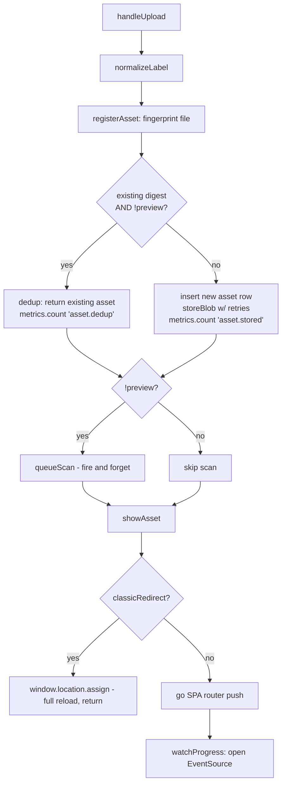

### Overview

`handleUpload` is a four-step pipeline — normalize label → register asset (hash + dedup + store) → fire off a background scan → navigate to the asset page. The three flags-driven branches (`preview`, dedup, `classicRedirect`) each cut out a different stage of that pipeline rather than adding new logic, which is why tracing them together matters.

### How It Works

**Normal path**: no existing digest match. `registerAsset` inserts a new row and awaits `storeBlob` (retried 3x via `withRetries`). Back in `handleUpload`, `queueScan` fires but is *not* awaited — it constructs a `ScanWorker`, runs it, and wires `.then`/`.catch` to `AssetStore.attachScan`/`markScanFailed` independently of the rest of the function. `showAsset` then does a client-side route push and opens an `EventSource` to stream scan/progress updates into `AssetStore.applyProgress`.

**Duplicate case**: `AssetStore.findByDigest` finds a match and `flags.preview` is falsy, so `registerAsset` short-circuits — it returns the *existing* asset object untouched. The freshly normalized `label` from this call is silently dropped (the existing record's label wins). No blob write, no `asset.stored` metric — just `asset.dedup`. Everything downstream still runs against this existing asset: a scan still gets queued (re-scanning an asset that may already have a verdict), and navigation still happens.

**Preview**: `flags.preview` flips the dedup condition off (`!flags.preview` is false), so even an identical digest is treated as new — `registerAsset` always inserts a fresh row and writes the blob, bypassing dedup entirely. Then in `handleUpload`, `queueScan` is skipped outright (`if (!flags.preview)`). Navigation and `watchProgress` still run normally, so a preview opens an `EventSource` for progress on an asset that will never receive scan events.

**classicRedirect**: orthogonal to the other two — it only affects `showAsset`, the last step. It fires *after* the scan has already been queued (if applicable), then does `window.location.assign` and returns before `go()` or `watchProgress()` run. No SPA nav, no `EventSource`.

### Gotchas

- **Dedup silently discards the new label.** Re-uploading the same bytes with a different label leaves the stored label unchanged — easy to mistake for a bug in label editing.
- **Preview always writes a blob**, even for byte-identical re-uploads — no dedup credit, no `asset.dedup` metric, a real row + blob every time.
- **classicRedirect can orphan the fire-and-forget scan.** `queueScan` starts before the redirect, but `window.location.assign` triggers a full page unload; the in-flight `ScanWorker` promise's `.then`/`.catch` may never execute client-side, so `attachScan`/`markScanFailed` can silently not run depending on timing.
- **Duplicate uploads still queue a scan** on the existing asset — not obviously wasteful, but worth knowing if `ScanWorker` isn't idempotent.