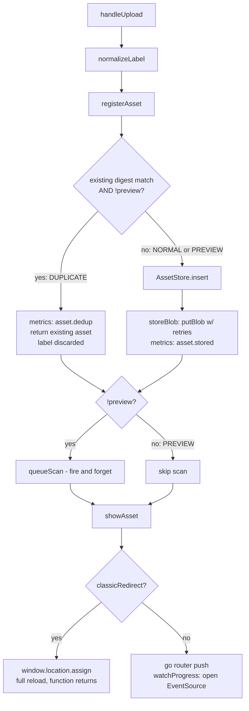

## Overview

`handleUpload` is the single entry point: normalize the label → register (or dedupe) the asset → optionally kick off a scan → show the result, either via SPA navigation + live progress or a hard redirect. Everything after `registerAsset` branches on the two flags independently, and the branches interact in a couple of non-obvious ways.

## How It Works

1. **`normalizeLabel`** — sync regex: `"#draft Q3 deck"` → `"draft: Q3 deck"`. No-op if the label doesn't start with `#tag`.

2. **`registerAsset`** — `fingerprint(file)` computes a content digest, then `AssetStore.findByDigest(digest)` looks for a match.
   - **Duplicate**: if a match exists *and* `!flags.preview`, it fires `metrics.count('asset.dedup')` and returns the existing `Asset` immediately — no insert, no blob write. The label you just normalized is thrown away; the caller gets back whatever label the original upload had.
   - **Normal / no match**: `AssetStore.insert({label, digest})` creates the row, then `storeBlob` writes it (`putBlob` wrapped in `withRetries({attempts: 3})`, then `metrics.count('asset.stored')`).
   - **Preview**: the `!flags.preview` guard means preview *always* takes the insert/store path, even when a digest match exists — it never returns an existing asset.

3. **Scan** — back in `handleUpload`, `queueScan(asset)` runs only if `!flags.preview`. It's not awaited: `ScanWorker.run()` resolves on its own time and writes the result back via `AssetStore.attachScan` (success) or `markScanFailed` (failure). `handleUpload` has already returned by then in most cases.

4. **`showAsset`**:
   - **classicRedirect**: `window.location.assign(...)` — full page reload, function returns immediately, `watchProgress` never runs.
   - **default**: `go(...)` does an SPA route change, then `watchProgress` opens an `EventSource` to `/api/assets/{id}/progress`, piping each message into `AssetStore.applyProgress`. On any stream error it just calls `es.close()` — no reconnect.

## Gotchas

- **Preview isn't a dry run.** It only changes two things: it bypasses the dedup short-circuit, and it skips `queueScan`. It still inserts a row, uploads the blob with retries, navigates, and (unless `classicRedirect`) opens a progress `EventSource` — which will then sit idle forever since no scan was ever queued to write progress into it.
- **Dedup ignores the new label.** If a non-preview upload matches an existing digest, the freshly normalized label is silently discarded in favor of the original asset's label.
- **Scan completion is unobservable from the caller.** `queueScan`'s promise chain is deliberately detached; `handleUpload` resolves right after `showAsset`, independent of whether the scan has even started.
- **`classicRedirect` skips progress tracking entirely** — by design, since the page is about to unload — so any progress UI logic only applies to the SPA path.
- **No reconnect on SSE errors.** A single network blip permanently kills progress updates for that asset until the user reloads.